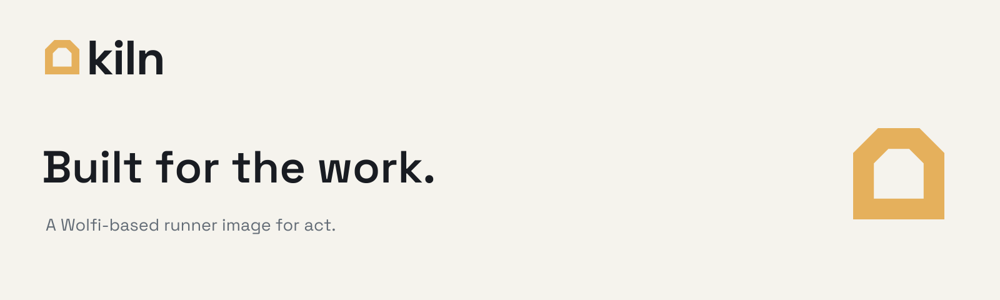

# Kiln



[](https://github.com/smeltery/kiln/actions/workflows/ci.yml)
[](https://github.com/smeltery/kiln/actions/workflows/publish.yml)
[](https://github.com/smeltery/kiln/releases)
[](https://wolfi.dev)
[](https://github.com/smeltery/kiln/pkgs/container/kiln)
[](docs/development.md)
[](package.json)
[](LICENSE)

Kiln provides the container environment that [act](https://github.com/nektos/act)
uses to run GitHub Actions workflows on your machine. Built on Wolfi Linux with
glibc, it includes shell utilities, Node.js, Python, a C/C++ toolchain, Git, and
Docker clients.

Images are published for AMD64 and ARM64 with signatures, software bills of
materials (SBOMs), and build provenance—a record of how each image was built.

```bash
docker pull ghcr.io/smeltery/kiln:latest
act -P ubuntu-latest=ghcr.io/smeltery/kiln:latest
```

Ubuntu-style tags are runner aliases; the image runs Wolfi and uses `apk`.
Workflows requiring `apt`, systemd, or a full GitHub-hosted VM need adaptation.

See [docs/](docs/README.md) for [usage](docs/usage.md),
[packages](docs/packages.md), [development](docs/development.md),
[build options](docs/building.md), and [releases](docs/automation.md).

[Bellows](https://github.com/smeltery/bellows) plans and orchestrates local
workflows; Kiln supplies the runner environment. Brand assets, fonts, tokens,
and usage guidance live in [assets/brand](assets/brand/README.md).

[PolyForm Shield License 1.0.0](LICENSE) · © 2026 smeltery.
