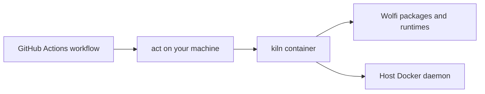

# Kiln Docs

<picture>
  <source media="(prefers-color-scheme: dark)" srcset="../assets/brand/logos/svg/kiln-reversed.svg">
  
</picture>

- [Use kiln](usage.md): pull an image, configure act, and diagnose failures.
- [Package reference](packages.md): tools available inside the runner.
- [Development](development.md): Flox, Bun, checks, hooks, and LOC limits.
- [Build reference](building.md): image variants and environment options.
- [Architecture](architecture.md): how both variants produce a Wolfi runner.
- [Automation and releases](automation.md): CI, versioning, and publishing.
- [Maintenance](maintenance.md): package updates and image verification.
- [Brand assets and guidelines](../assets/brand/README.md): logos, fonts, colors,
  and repository artwork.

