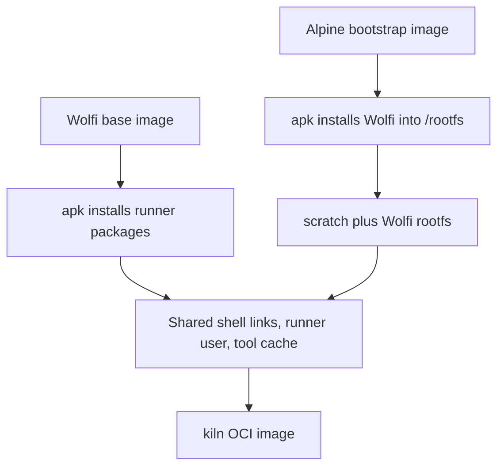

# Architecture

kiln provides a glibc-native Wolfi userland for act. The Dockerfile selects one
of two routes with `BUILD_MODE`; both share the final runner configuration.

## Direct mode

The default starts from `cgr.dev/chainguard/wolfi-base:latest` and installs the
[package set](packages.md) using Wolfi's apk. Use it when the registry is reachable.

## Bootstrap mode

The fallback uses Alpine's apk-tools to install Wolfi packages into `/rootfs`,
then copies that root into `scratch`. Alpine binaries stay in the build stage.
This bypasses the base-image registry; it is not an offline build.

Wolfi uses a merged `/usr` layout. The bootstrap pre-creates `/lib` as a symlink
to `usr/lib` so apk's database creation does not conflict with `wolfi-baselayout`.
It skips package scripts to avoid executing glibc binaries under Alpine's musl.
The final stage restores required shell links explicitly; package additions
must be smoke-tested in both modes because skipped scripts may have side effects.

The signing key is fetched over HTTPS and apk verifies package signatures.
This trust path depends on the key download and is distinct from verifying a
signed base image. See [maintenance](maintenance.md) for published-image checks.

## Runner conventions

Both variants create a `runner` user with passwordless sudo, provide Node links
under `/usr/local/bin`, and configure `/opt/hostedtoolcache`. act normally executes
steps as root. Docker access uses the host daemon, not a daemon inside kiln.
Ubuntu-style image tags do not change the operating system or package manager.
