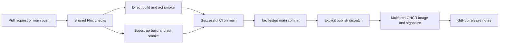

# Automation and releases



## Continuous integration

[CI](../.github/workflows/ci.yml) runs on pull requests, main pushes, `ci/**`
branches, and manual dispatch. It uses the same Flox/Bun checks as local hooks,
then builds and smoke-tests direct and bootstrap images with act. New commits
cancel obsolete CI runs. Each job has a timeout and read-only default permissions.

[PR validation](../.github/workflows/pr-validation.yml) checks conventional titles.
The [smoke workflow](../.github/workflows/smoke.yml) is run inside kiln by act;
manually running it on GitHub would test the host runner instead.
Dependabot maintains action pins, Docker references, and Bun dependencies.

## Automatic releases

[Auto release](../.github/workflows/auto-release.yml) follows successful push CI
on main. It checks out the tested SHA and skips it if main has moved. Under a
serialized release job it reuses an existing version tag, or creates `v0.1.0`
initially and increments the patch number thereafter.

It explicitly dispatches publishing with that tag: tags pushed by GitHub's
workflow token do not trigger another push workflow. Re-running auto release
retries publishing with the same tag. This workflow becomes active after merge
to the default branch. No personal access token is needed.

## Publishing

[Publish](../.github/workflows/publish.yml) runs for `v*` tags, Sunday 09:00 UTC
rebuilds, and manual dispatch. It builds AMD64 and ARM64, pushes to GHCR, signs
the digest with keyless cosign, and attaches BuildKit SBOM and provenance.
A versioned publish creates generated GitHub release notes after signing.

Scheduled builds disable build cache to refresh Wolfi packages even when source
is unchanged. Version and source tags can be republished; pin a digest for
immutability. Automatic release builds use the tested source, but package
resolution can still change between CI and publishing.

```bash
# Rebuild the development image, or retry a particular existing release.
gh workflow run publish.yml
gh workflow run publish.yml -f tag=v0.1.0
gh run list --workflow publish.yml
gh run watch RUN_ID --exit-status
```

Release and publish jobs serialize writes. Release jobs can write tags and
trigger workflows; publishing can write packages, releases, and OIDC signatures.
