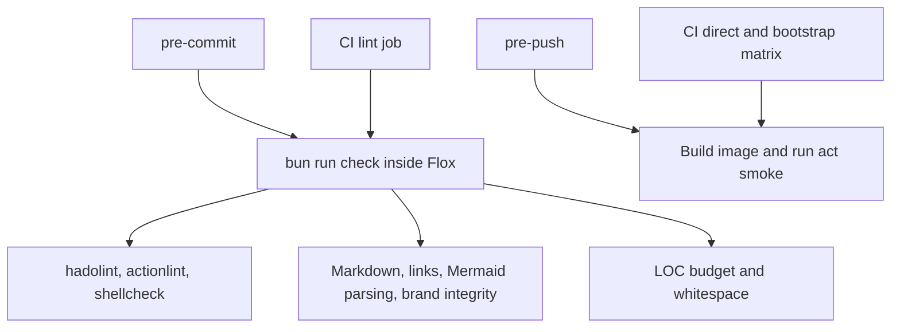

# Development

Install [Flox](https://flox.dev/docs/install-flox/) and a Docker daemon, then:

```bash
flox activate
npm ci --ignore-scripts
pre-commit install --hook-type pre-commit --hook-type pre-push
bun run check
scripts/build.sh
scripts/test.sh
```

Flox supplies Bash, Bun, Node.js, act, pre-commit, and all native linters.
The manifest pins Nix package inputs and the committed lockfile fixes their
resolved builds across Linux and Apple Silicon macOS. No FloxHub account is required.
Docker remains a host service; Flox does not start a daemon.

npm installs the locked documentation dependencies; Bun runs the check scripts.
Node.js is available for tools whose executables use a Node shebang.
Activation does not install dependencies or modify Git hooks automatically.

## Checks and hooks



`pre-commit run --all-files` runs the same static checks as CI.
The pre-push hook runs `scripts/verify-images.sh`, building and smoke-testing
both direct and bootstrap variants, just like the CI matrix. Hook installation is local to each checkout.

Markdown validation covers README, documentation, and brand usage guidance. Mermaid fences are
parsed by Mermaid itself with an in-memory DOM; relative file links must exist.
External URLs and fragment anchors are not checked. Diagram layout still needs
visual review on GitHub.

`bun run brand:check` verifies the [brand library](../assets/brand/README.md)
as part of these shared checks. Review intentional asset changes, then run
`bun run brand:update` to update its SHA-256 manifest.

## Keep changes lean

`bun run check:loc` enforces at most **250 nonblank lines per file** and
**1,000 total** across the Dockerfile, shell/TypeScript scripts, test scripts,
GitHub YAML, and hook/Bellows configuration. Comments count. Documentation, dependency locks, and generated
files are excluded. Prefer shared checks to separate hook and CI implementations;
change the limits only with an explicit rationale in review.

To update tools, change the pinned Nix revision in `.flox/env/manifest.toml`,
run `flox edit --sync`, and commit the manifest and lockfile together.
For JavaScript dependencies, use `npm update --ignore-scripts` and commit
`package-lock.json`. The `re2js` and `katex` overrides select patched versions
until the documentation tools update their transitive dependencies.

## Local verification with Bellows

Install [Bellows](https://github.com/smeltery/bellows) and commit your changes.
The native Flox profile verifies the committed tree, runs the shared lint checks,
then builds and smoke-tests both image modes through act:

```bash
git fetch origin main
bellows verify --repository smeltery/kiln --base origin/main --head HEAD \
  --profile local --format json
```

Bellows retains a local receipt identifying the tested commit and check results.
Uncommitted edits are excluded. This is useful when hosted runners are
unavailable; it does not test GitHub permissions, OIDC signing, or registry
publishing, and does not turn a hosted check green.

For a quick workflow run against `kiln:dev`, use `scripts/build.sh` followed by
`bellows run`. The default Bellows workflow is the smoke suite, so it cannot
publish an image or create a release.
